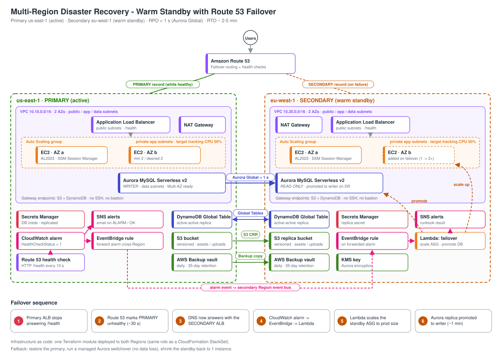

# Multi-Region Disaster Recovery on AWS — Warm Standby with Route 53 Failover

Graduation project for **AWS Solutions Architect – Associate** (Manara, AWS 2 — Project 5: *Multi-Region Disaster Recovery with Route 53 Failover*).

A web application runs in **us-east-1 (primary)** with a **warm standby** copy in **eu-west-1 (secondary)**. Route 53 health checks detect a primary-Region failure and fail DNS over automatically; an EventBridge + Lambda runbook scales the standby up to production size and can promote the Aurora Global Database in the secondary Region to writer.

| Target | Value | How |
|---|---|---|
| **RPO** (data loss) | **< 1 second** for the database | Aurora Global Database storage-level replication |
| **RTO** (downtime) | **~2–5 minutes** | Route 53 detection (~30 s) + DNS TTL (60 s) + ASG scale-up + Aurora promotion (~1 min) |
| Infrastructure | 100% code | Terraform; one module deployed identically to both Regions |

---

## Architecture



> The diagram is generated from [`docs/diagram.py`](docs/diagram.py) (a PNG copy is in [`docs/architecture.png`](docs/architecture.png)).

### Components

| Layer | Service | Primary (us-east-1) | Secondary (eu-west-1) |
|---|---|---|---|
| DNS | **Route 53** | Failover record `PRIMARY` + HTTP health check every 10 s | Failover record `SECONDARY` |
| Network | **VPC** | 10.10.0.0/16, 2 AZs, public / app / data subnets, NAT GW, S3 + DynamoDB gateway endpoints | 10.20.0.0/16, same layout (non-overlapping CIDR) |
| Load balancing | **ALB** | Internet-facing, health checks `/health` | Same |
| Compute | **EC2 + Auto Scaling** | 2 instances (min 2 / max 4), target tracking CPU 50% | **1 instance** (warm), scaled to 2+ on failover |
| Database | **Aurora MySQL Serverless v2 — Global Database** | Writer cluster | Read-only secondary cluster, promoted on DR |
| Key/value data | **DynamoDB Global Table** | Replica (read/write) | Replica (read/write) — active-active |
| Objects | **S3 Cross-Region Replication** | Source bucket (versioned) | Replica bucket, Replication Time Control (15 min SLA) |
| Backups | **AWS Backup** | Daily backup of everything tagged `Backup=true`, 35 days | Cross-Region copy of every backup |
| Secrets | **Secrets Manager** | DB credentials | Replica secret |
| Detection | **CloudWatch + EventBridge** | Alarm on `HealthCheckStatus`, rule forwards the alarm to the secondary Region | Rule invokes the failover Lambda |
| Automation | **Lambda** | — | Scales the standby ASG, optionally promotes Aurora, reports to SNS |
| Access | **Systems Manager** | Session Manager (no SSH keys, no bastion) | Same |

### Request flow (normal operation)

1. Users resolve `app.example.com`; Route 53 answers with the **primary ALB** because its health check is green.
2. The ALB forwards to EC2 instances in private subnets.
3. The app writes to Aurora (writer in us-east-1) and to its local DynamoDB replica.
4. Aurora, DynamoDB, S3 and AWS Backup continuously replicate to eu-west-1.

### Failover flow (primary Region down)

1. The primary ALB stops answering `/health`.
2. Route 53 health checkers (running from many locations worldwide, independent of us-east-1) mark the primary unhealthy after 3 failed checks (~30 s).
3. Route 53 starts answering with the **secondary ALB**; clients follow once the 60 s TTL expires.
4. The CloudWatch alarm on the health check goes to `ALARM` → EventBridge forwards the event to the eu-west-1 event bus → the **failover Lambda** runs.
5. The Lambda scales the standby ASG to production size (2 instances) and emails the result via SNS.
6. The Aurora secondary is promoted to writer — automatically if `auto_promote_database = true`, otherwise an operator runs [`scripts/promote-secondary-db.sh`](scripts/promote-secondary-db.sh) after confirming the outage (avoids a split-brain on a false alarm).

**Failback** ([`scripts/failback.sh`](scripts/failback.sh)): restore the primary web tier, run a *managed* Aurora switchover back to us-east-1 (no data loss because both Regions are healthy), shrink the standby back to 1 instance. Route 53 returns traffic to the primary automatically when its health check is green again.

---

## The four AWS DR strategies (and why Warm Standby)

| Strategy | What runs in the DR Region | RPO | RTO | Cost | Fits when |
|---|---|---|---|---|---|
| **Backup & Restore** | Nothing — only backups copied there | Hours (last backup) | Hours (rebuild everything) | $ | Non-critical systems, tight budget |
| **Pilot Light** | Core data replicated (DB); compute *off* | Seconds–minutes | Tens of minutes (launch compute) | $$ | Data must be safe, some downtime OK |
| **Warm Standby** ✅ | Full stack running at **reduced size** | Seconds | **Minutes** (scale up) | $$$ | Business-critical apps, minutes of downtime acceptable |
| **Multi-Site Active/Active** | Full stack at full size, both serving | ~0 | ~0 (near-instant) | $$$$ | Zero-downtime requirements, global users |

**This project implements Warm Standby** because it gives a minutes-level RTO and sub-second RPO at a fraction of the active/active cost: the secondary Region already runs every component (ALB, 1 EC2 instance, Aurora reader), so failover is a *scale-up*, not a *rebuild*. The data layer is already partly active/active (DynamoDB Global Tables), which shows how the design can grow toward Multi-Site later.

---

## Repository structure

```
.
├── README.md
├── docs/
│   ├── architecture.svg        # diagram used in this README
│   ├── architecture.png
│   └── diagram.py              # regenerates the diagram
├── scripts/
│   ├── simulate-region-failure.sh   # scales the primary ASG to 0
│   ├── watch-failover.sh            # shows which Region answers, every 5 s
│   ├── promote-secondary-db.sh      # unplanned Aurora failover (manual mode)
│   └── failback.sh                  # return to the primary Region
└── terraform/
    ├── versions.tf             # providers: aws.primary + aws.secondary
    ├── variables.tf
    ├── main.tf                 # secret + the regional module twice
    ├── aurora.tf               # Aurora Global Database (Serverless v2)
    ├── storage.tf              # DynamoDB Global Table, S3 CRR
    ├── backup.tf               # AWS Backup with cross-Region copy
    ├── dns.tf                  # Route 53 health checks + failover records
    ├── failover.tf             # CloudWatch alarm, EventBridge, SNS, Lambda
    ├── outputs.tf
    ├── terraform.tfvars.example
    ├── lambda/failover/handler.py
    └── modules/region/         # VPC, subnets, NAT, SGs, ALB, ASG, app (user data)
```

**Why a Terraform module instead of CloudFormation StackSets?** Both solve the same problem — deploying *identical* infrastructure to several Regions from one definition. Here the `modules/region` module is instantiated twice with two provider aliases, so both Regions are always built from the same code. With CloudFormation the equivalent is one template deployed as a StackSet to `us-east-1` and `eu-west-1`.

---

## Deploy

### Prerequisites

- AWS account and credentials with admin rights (`aws sts get-caller-identity` works)
- Terraform ≥ 1.6, AWS CLI v2, `bash` and `python3` for the scripts
- Optional: a Route 53 public hosted zone (e.g. `example.com`) for the failover DNS name

### Steps

```bash
cd terraform
cp terraform.tfvars.example terraform.tfvars   # set hosted_zone_id / app_domain_name / alert_email
terraform init
terraform apply
```

The first apply takes **~30–40 minutes** (the Aurora Global Database secondary cluster is the slowest part). When it finishes:

```bash
terraform output app_url            # the failover URL (or the primary ALB if no domain)
terraform output secondary_alb_url  # the standby, reachable directly for testing
```

Open the URL: the page shows the Region, AZ and instance that served the request, a visit counter stored in the DynamoDB Global Table, and whether the Aurora endpoint is reachable. Open the secondary ALB URL as well — the visit counter is the same number, proving the global table replicates.

> Without a domain, the health check, alarm and Lambda still deploy and work; only the DNS switch is skipped, so you test by calling both ALB URLs directly.

---

## Failover drill (demo)

```bash
# terminal 1 — watch which Region answers
./scripts/watch-failover.sh

# terminal 2 — break the primary
./scripts/simulate-region-failure.sh
```

Expected timeline:

| Time | What you see |
|---|---|
| 0:00 | Primary ASG scales to 0, the primary ALB returns `503` |
| ~0:30 | Route 53 health checkers report failure; `watch-failover.sh` shows the count of healthy checkers drop to 0 |
| ~1:00–1:30 | The app URL starts answering from **eu-west-1 (secondary)** |
| ~1:30 | CloudWatch alarm → EventBridge → Lambda; SNS email "DR failover triggered"; the secondary ASG goes from 1 to 2 instances |
| ~2:30 | (Manual mode) run `./scripts/promote-secondary-db.sh`; Aurora in eu-west-1 becomes the writer in ~1 minute |

Then return to normal:

```bash
./scripts/failback.sh
```

---

## Security

- **No public instances:** EC2 and Aurora live in private subnets; only the ALB is public. The data subnets have no internet route at all.
- **Least-privilege security groups:** internet → ALB:80 → app:80 → Aurora:3306, each tier only accepts the tier in front of it.
- **No SSH:** instances are managed through Systems Manager Session Manager; IMDSv2 is enforced.
- **Encryption at rest:** Aurora (AWS-managed key in us-east-1, customer-managed KMS key in eu-west-1), S3 default encryption, DynamoDB default encryption, Secrets Manager.
- **Secrets:** the DB password is generated by Terraform, never written in code, stored in Secrets Manager and replicated to the DR Region.
- **IAM:** each role (instance, Lambda, S3 replication, Backup, EventBridge forwarding) only has the actions it needs.

## Cost (approximate)

Rough monthly estimate with the defaults, both Regions, light traffic — check the [AWS Pricing Calculator](https://calculator.aws/) for your own numbers:

| Item | ≈ USD / month |
|---|---|
| 2 × NAT Gateway | 66 |
| 2 × ALB | 33 |
| 3 × t3.micro EC2 | 23 |
| Aurora Serverless v2, 0.5 ACU min in each Region + storage/replication | 90–110 |
| Route 53 health checks, S3, DynamoDB, Backup, Lambda, CloudWatch | < 10 |
| **Total** | **~ $220–250** (≈ $8/day) |

For a demo, deploy, record the drill, then **destroy** — running it for a day costs a few dollars.

## Clean up

```bash
cd terraform
terraform destroy
```

If you promoted the Aurora secondary during a drill, run `./scripts/failback.sh` first (or remove the clusters from the global database) so `destroy` can delete them cleanly.

---

## Production improvements (beyond the project scope)

- HTTPS: ACM certificates in both Regions + an HTTPS listener and HTTP→HTTPS redirect, WAF on both ALBs.
- One NAT Gateway per AZ (this demo uses one per Region to save cost).
- Aurora write forwarding or an application-level switch so the secondary Region's app writes after promotion without a redeploy.
- Route 53 Application Recovery Controller for operator-controlled, safety-checked failover.
- Remote Terraform state (S3 + DynamoDB lock) and a CI/CD pipeline for `plan`/`apply`.
- Regular game days: run the drill on a schedule and record the measured RTO/RPO.

## What this project demonstrates

- Comparing the four DR strategies by RTO, RPO and cost, and implementing **Warm Standby**
- Route 53 **failover routing** with health checks and TTL considerations
- **Aurora Global Database** for sub-second cross-Region RPO, plus unplanned failover vs managed switchover
- **S3 Cross-Region Replication** with an IAM replication role and Replication Time Control
- **DynamoDB Global Tables** for active-active data
- Deploying identical multi-Region infrastructure from one definition (Terraform module ≈ CloudFormation StackSets)
- Recovery automation with **CloudWatch alarms, cross-Region EventBridge and Lambda**
- **AWS Backup** with cross-Region copies as protection against corruption that replication would also copy
